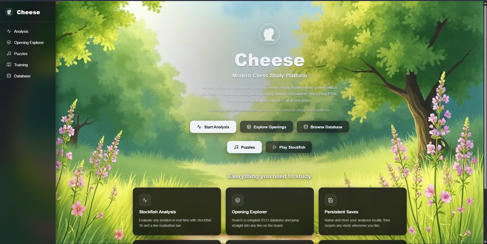
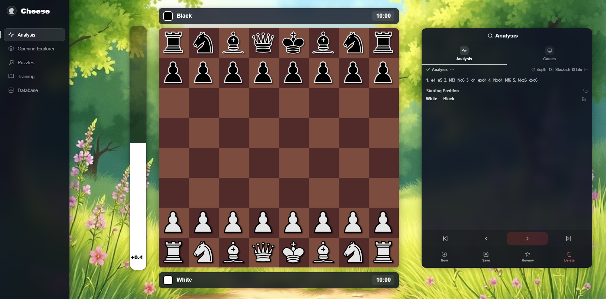
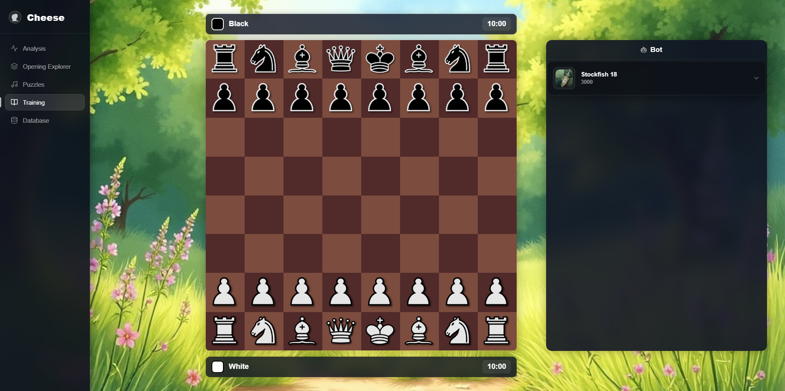

# Cheese

> A modern browser-based chess study platform.

**Live at [usecheese.xyz](https://usecheese.xyz)**

> ### Cheese has been discontinued — November 10, 2026
>
> Development of Cheese has ended. The site will remain available for chess
> analysis, opening exploration, browsing master games, and playing against
> Stockfish, but it will no longer receive updates or support.
>
> **The Puzzle Trainer has been retired and is no longer supported.**
>
> Thank you to everyone who spent time studying and playing with Cheese.
> The source remains available under GPL-3.0 for anyone who wants to study
> it or continue development in a fork.

---

## Overview

**Cheese** is a desktop-focused chess study platform. Its remaining study tools let you analyse games with Stockfish, explore openings, browse master games, and play against the engine in one calm workspace.

Analysis, opening exploration, master-game browsing, and playing Stockfish run in your browser without the Cheese API or an account. Saved analyses remain in your browser's `localStorage`.

The Puzzles page now displays a retirement message instead of the trainer and no longer requests puzzles. The original puzzle and account backend is retained in [`server/`](server/) for reference and self-hosting. Account and profile pages remain in the source, but depend on Clerk and the Cheese API; they are no longer supported.

A discontinuation notice appears on the first normal page opened in each tab session. Dismissing it carries across navigation and reloads in that tab. The 404 page is excluded.

Cheese is **desktop-only**. At widths of 768px or less, a notice replaces the normal layout. Mobile support is not planned.

---

## Remaining Features

These tools remain available on the site, without further updates or support.

| Feature | Description |
| --- | --- |
| **Stockfish 18 Analysis** | Analyse any position with the Stockfish 18 engine, including an evaluation bar and engine lines. |
| **Opening Explorer** | Browse openings by ECO code and hand off any line straight into Analysis. |
| **Play Against Stockfish** | Play full games versus the engine — choose your colour, with automatic board orientation and turn enforcement. |
| **Master Game Database** | Explore curated collections of games from legendary players, parsed dynamically from PGN. |
| **Local Save System** | Save your analyses locally in the browser and revisit them anytime. |
| **PGN Import** | Load games via PGN and review them move by move. |
| **Move Navigation** | Step forwards and backwards through any game with a clean move list. |
| **Navigation Back to Study** | The branded 404 page and retired Puzzles page offer links back to the study tools. |
| **Remembers Your Settings** | Your Training colour persists across visits. |
| **Modern Glassmorphism UI** | A consistent dark, glassmorphism-inspired interface across every page. |
| **No Build Step** | The website is plain HTML, CSS and JavaScript — no bundler, no framework. |

---

## Project Structure

| Path | Contents |
| --- | --- |
| `index.html`, `pages/` | The static website — one folder per page |
| `404.html` | Shown for any unknown URL (picked up automatically by Cloudflare Pages) |
| `assets/` | Shared CSS, JS, pieces, sounds and images |
| `engine/` | Stockfish 18 (WebAssembly) |
| `library/` | Static content: ECO openings, master game PGNs |
| `docs/` | Changelog and technical documentation artifacts |
| `server/` | Retained puzzle and account backend source — see [`server/README.md`](server/README.md) for setup |
| `.github/workflows/` | CI — runs lint and the backend test suite on every push to `main` and every pull request |
| `_headers` | Response headers applied by Cloudflare Pages |
| `eslint.config.mjs` | Lint rules for both the frontend and `server/` — run via `npm run lint` in `server/` |

Only seven files sit at the repository root, and each has to: `index.html` and
`404.html` are served from there, `_headers` is only read from there,
`README.md`, `LICENSE` and `.gitignore` are expected there by GitHub and git,
and `eslint.config.mjs` must live there because ESLint resolves a flat
config's `files` patterns against the working directory it's run from, not
the config's own location (see that file's own header for why it's still
kept out of a root `package.json`, which would risk tripping Cloudflare
Pages' build detection). Everything else lives in a folder.

The static website and API deploy independently. The frontend is configured
for Cloudflare Pages, and the backend for Railway with persistent SQLite
storage (see [`server/README.md`](server/README.md)). The remaining study
tools and retired Puzzles page do not depend on the API. Account and profile
features still require their external services; discontinuation does not
remove their source or delete stored data.

---

## Scope — what Cheese does *not* do

Development has ended. These limitations remain, with no planned updates:

- **Mobile** — Cheese is desktop-only and shows an explanatory notice at
  768px or less.
- **Cloud-synced saved analyses** — saved analyses live only in your browser's `localStorage`, so they
  do not follow you across devices
- **Puzzle training** — the Puzzle Trainer is retired; solving puzzles and
  earning new puzzle ratings through the site are no longer available
- **Accessibility** — the board is not keyboard-navigable, there is no
  screen-reader support for board play, and most existing animations do not
  respect `prefers-reduced-motion`
- **Link previews** — no Open Graph tags, so a shared Cheese link renders no
  preview card

Cheese is [GPL-3.0](#license) — if you want any of the above, you are free to
fork it and build them.

---

## Screenshots

These screenshots show the study interface before the discontinuation notice was added.

**Home**

**Analysis**

**Database**

**Training**

---

## Technologies Used

| Technology | Role |
| --- | --- |
| **HTML5** | Page structure |
| **CSS3** | Styling, layout, and glassmorphism design |
| **JavaScript** | Application logic (vanilla, no framework) |
| **chess.js** | Move generation, legality, and game state |
| **Stockfish 18** | Chess engine (WebAssembly, runs in a Web Worker) |
| **PGN parsing** | Reading and splitting master games and imports |
| **Node.js + Express** | Retained backend API source (retired puzzles and unsupported account features) |
| **SQLite** | Original puzzle datastore (1.7M sampled puzzles from a 5.8M import), plus a separate accounts database |
| **Clerk** | Authentication and session management for the retained account pages |

---

## Design Philosophy

Cheese is built to be a **calm, distraction-free environment for studying chess**. The interface stays quiet and out of the way so the board and your analysis remain the focus, while a modern, consistent look keeps the whole experience cohesive from page to page. The goal is simple: a study platform that feels focused, polished, and pleasant to spend time in.

---

## Project History

**v1.4.2** was the last release before discontinuation. Development ended on
**November 10, 2026**.

Cheese was built between May and August 2026, from a single analysis board
([v1.0](docs/CHANGELOG.md)) to a nine-page study platform with its own backend,
puzzle database, account system, and now an automated test suite and CI. That
run ended at v1.4.1; development resumed and v1.4.2 added backend tests and
CI. The final website update adds the discontinuation notice and retires the
Puzzle Trainer. Earlier release history is in the [changelog](docs/CHANGELOG.md).

---

## License

This project is licensed under the **GNU General Public License v3.0 (GPL-3.0)**.

You are free to use, study, share, and modify Cheese under the terms of the GPL-3.0. Any distributed derivative works must remain under the same license. See the [LICENSE](LICENSE) file for the full text.

© 2026 Vihaan Productions™

---

## Thank You

Thanks for being part of **Cheese**. It started as a chessboard that could barely
track a move and grew into a complete study platform. Development has ended,
but the remaining tools stay available for you to study and enjoy.

Thank you to everyone who spent time studying and playing with Cheese.

Enjoy your study, and happy analysing. ♟️🧀
